# ⚡ VELOX — E-Commerce de Calzado Deportivo de Alto Rendimiento (EFI 2026)

Repositorio oficial del Examen Final Integrador (EFI 2026) — **ITEC Río Cuarto**:
- **Ingeniería de Software (Backend Django 6 + DRF)** — Prof. Facundo Lemo
- **Programación III (Frontend Next.js App Router)** — Prof. Valentino Arballo

---

## 🏃 Temática e Identidad del Sistema

**VELOX** es una plataforma de comercio electrónico de alto rendimiento especializada en calzado deportivo técnico para atletas y corredores de competición. El sistema refleja una identidad visual moderna basada en una paleta de alto contraste en modo oscuro (`#0A0A0A`, `#141414`, `#1F1F1F`) con resplandor verde neón (`#39FF14`) representativo de la energía reactiva de la placa de fibra de carbono.

La arquitectura del proyecto está desacoplada: una aplicación frontend moderna en **Next.js 16 (App Router)** que consume de forma nativa la **API RESTful de Ingeniería de Software** construida en **Django 6 + Django REST Framework**, soportando autenticación JWT con Cookies HTTP-Only, cálculo y validación de inventario en tiempo real, gestión transaccional de órdenes de compra con restitución de stock y administración completa de roles y usuarios.

### 🔗 Enlaces Principales del Proyecto

| Recurso | Enlace de Producción | Descripción |
| :--- | :--- | :--- |
| **🌐 Frontend Desplegado** | [proyecto-velox.vercel.app](https://proyecto-velox.vercel.app/) | Aplicación web completa en producción en Vercel |
| **☁️ API REST Desplegada** | [velox-backend-smxi.onrender.com/api/](https://velox-backend-smxi.onrender.com/api/) | Backend Django 6 + DRF en producción en Render |
| **📘 Documentación Swagger UI** | [velox-backend-smxi.onrender.com/api/docs/](https://velox-backend-smxi.onrender.com/api/docs/) | Interfaz interactiva OpenAPI 3 con prueba de endpoints JWT |
| **📑 Documentación ReDoc** | [velox-backend-smxi.onrender.com/api/redoc/](https://velox-backend-smxi.onrender.com/api/redoc/) | Especificación técnica de contratos, tipos y esquemas |
| **📌 Tablero Kanban (Trello)** | [trello.com/b/frG8yKLI/proyecto-velox](https://trello.com/b/frG8yKLI/proyecto-velox) | Tablero ágil oficial con flujo de trabajo y tareas del equipo |

---

## 👥 Integrantes del Equipo

- **Manuel Gómez** — Backend 1 (Core, Usuarios, Auth Dual JWT/Session, Pedidos, Reseñas y Deploy en Render)
- **Valentino Cambria** — Backend 2 (Catálogo de 8 Modelos, Variantes SKU, ViewSets, Filtros y Documentación OpenAPI)
- **Juan Falco** — Frontend 1 (UI Kit VELOX, Home, Catálogo Paginado, Ficha Dinámica y Autenticación JWT)
- **Tomás Benavidez** — Frontend 2 (CartContext, Schemas Zod, Checkout Transaccional, Dashboard CRUD y Tests Vitest)

---

## 📋 Metodología Ágil y Organización del Trabajo (Kanban en Trello)

Para asegurar la coordinación continua entre los 4 integrantes del equipo durante el desarrollo tanto del Backend como del Frontend, se implementó la metodología ágil **Kanban** utilizando la plataforma **Trello**:

- **Enlace al Tablero Oficial:** [https://trello.com/b/frG8yKLI/proyecto-velox](https://trello.com/b/frG8yKLI/proyecto-velox)
- **Estructura de Columnas:**
  1. `📋 Backlog`: Requisitos de la consigna y requerimientos técnicos desglosados en tarjetas atómicas con fecha límite y responsables asignados.
  2. `📌 Sprint Actual`: Tareas priorizadas para el ciclo de entrega inmediato.
  3. `🔨 En Desarrollo`: Tareas en curso asignadas a ramas específicas `feature/*`.
  4. `👀 Code Review / Testing`: Tareas finalizadas en espera de revisión obligatoria de código (Pull Request con al menos 3 aprobaciones del resto del equipo antes de fusionar a `develop`).
  5. `✅ Done`: Tareas completadas con fecha de vencimiento marcada en verde, tests automatizados verificados y documentación viva actualizada (`README.md` y `docs/bitacora_defensa.md`).

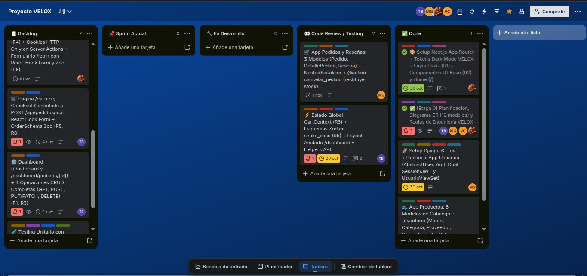

---

## 📂 Estructura del Monorepo

- `frontend/`: Aplicación web moderna en Next.js 16 (App Router) + React 19 + Tailwind CSS v4 con Vitest y Testing Library.
- `backend/`: API RESTful en Django 6 + Django REST Framework gestionada con `uv` y Docker (PostgreSQL / SQLite).
- `docs/`: Documentación técnica de arquitectura, manual de identidad VELOX, consignas del EFI, bitácora de defensa oral (`docs/bitacora_defensa.md`) y capturas de pantalla de verificación.

---

## ⚛️ Frontend — Next.js 16 App Router (Programación III)

### 1. Variables de Entorno
Copiar la plantilla `.env.example` hacia `.env.local` dentro del directorio `frontend/`:

```bash
cd frontend
cp .env.example .env.local
```

Variables de entorno configuradas:

| Variable | Valor de Desarrollo | Valor de Producción | Descripción |
| :--- | :--- | :--- | :--- |
| `NEXT_PUBLIC_API_URL` | `http://localhost:8000/api` | `https://velox-backend-smxi.onrender.com/api` | URL base del Backend en Django REST Framework |

### 2. Instalación y Servidor de Desarrollo
```bash
cd frontend
npm install
npm run dev
```
La aplicación estará disponible localmente en `http://localhost:3000` y en producción en [https://proyecto-velox.vercel.app/](https://proyecto-velox.vercel.app/).

### 3. Rutas y Páginas Implementadas (App Router)
- **Rutas Principales, Anidadas y Dinámicas (R1):**
  - `/` (`src/app/page.jsx`): Landing Page y Hero Section con estética cyberpunk/atlética, estadísticas de producto y consumo de `GET /api/productos/destacados/`.
  - `/tecnologia` (`src/app/tecnologia/page.jsx`): Manifiesto técnico e ingeniería biomecánica (placa de carbono de doble densidad, drop aerodinámico y retorno de energía reactiva).
  - `/productos` (`src/app/productos/page.jsx`): Catálogo general de calzado con Server Component que consume el sobre paginado de DRF (`{ count, next, previous, results }`), sincronización bidireccional con query params y fallback completo.
  - `/productos/[id]` (`src/app/productos/[id]/page.jsx`): 1ra ruta dinámica obligatoria con Server Component para SEO y metadata, e hidratación del Client Component `ProductDetailClient.jsx` para galería de fotos (1:N), selector interactivo de talles AR y colores SKU con validación de stock en tiempo real y módulo de reseñas.
  - `/carrito` (`src/app/carrito/page.jsx`): Carrito de compras y checkout interactivo conectado al estado global `CartContext` y al endpoint transaccional `POST /api/pedidos/` con autenticación JWT, selector de cantidades, validación RHF + Zod (`checkoutFormSchema` y `orderSchema`), confirmación modal y captura de errores estructurados.
  - `/login` (`src/app/login/page.jsx`): Formulario de inicio de sesión con React Hook Form + Zod (`loginSchema`), conectado a Server Action (`loginAction`) para persistencia en Cookies HTTP-Only y `localStorage`, con botones de acceso rápido para la defensa (`admin` y `cliente1`).
  - `/register` (`src/app/register/page.jsx`): Formulario de registro público de clientes con React Hook Form + Zod (`registerSchema`), conectado al endpoint `POST /api/usuarios/` con auto-login posterior.
  - `/mis-pedidos` (`src/app/mis-pedidos/page.jsx`): Vista exclusiva para clientes autenticados (`rol="CLIENTE"`) con listado de compras propias, estados en tiempo real y acceso a detalle.
  - `/dashboard` (`src/app/dashboard/layout.jsx` y `page.jsx`): Layout anidado exclusivo para personal (`ADMIN` / `EMPLEADO`) con KPIs en tiempo real del catálogo (stock en depósito, variantes activas, valor de inventario) y módulo interactivo de 4 operaciones CRUD (`DashboardCrudManager.jsx`).
  - `/dashboard/pedidos` (`src/app/dashboard/pedidos/page.jsx`): Listado reactivo de órdenes consumiendo `GET /api/pedidos/` con JWT, pestañas de filtrado por estado (`TODOS`, `PENDIENTES`, `PAGADOS`, `ENVIADOS`, `ENTREGADOS`, `CANCELADOS`), badges visuales y buscador en vivo.
  - `/dashboard/pedidos/[id]` (`src/app/dashboard/pedidos/[id]/page.jsx`): 2da ruta dinámica obligatoria con ficha completa de la orden (`GET /api/pedidos/{id}/`), desglose de artículos (SKU, talle, color, cantidad, subtotal), datos del cliente y botón transaccional para ejecutar la `@action` `POST /api/pedidos/{id}/cancelar_pedido/` con confirmación en modal y restitución de stock atómica en base de datos.
  - `/dashboard/usuarios` (`src/app/dashboard/usuarios/page.jsx`): Panel exclusivo para `ADMIN` para auditoría de usuarios y modificación interactiva de roles (`ADMIN`, `EMPLEADO`, `CLIENTE`).
  - **Manejo Global de Estados de Carga y Error:** `src/app/layout.jsx` (Layout raíz con `CartProvider`), `src/app/loading.jsx` (esqueletos de carga animados), `src/app/error.jsx` (recuperación declarativa de errores en runtime) y `src/app/not-found.jsx` (página 404 personalizada con enlace de retorno).

- **Componentes Reutilizables Base (R2):**
  - `src/components/DashboardCrudManager.jsx` (`Client Component` — módulo interactivo para las 4 operaciones CRUD: `GET` paginado de variantes/reseñas, `POST` alta de variantes y reseñas, `PATCH` ajuste reactivo de stock/precio y `DELETE` con confirmación modal).
  - `src/components/PedidoDetalleClient.jsx` (`Client Component` — ficha técnica de pedido con desglose de calzados, cálculo de totales, modal accesible y ejecución de `@action` `cancelar_pedido`).
  - `src/components/ProductCard.jsx` (`Client Component` — tarjeta de calzado con selector en vivo de talle AR, recálculo dinámico de SKU/precio y compra directa a `CartContext`).
  - `src/components/FilterBar.jsx` (`Client Component` — barra de filtrado declarativa por búsqueda de texto, marcas, categorías, géneros, pills de talles AR y ordenamiento por precio o fecha).
  - `src/components/ProductDetailClient.jsx` (`Client Component` — isla interactiva de ficha técnica con galería de imágenes, variantes SKU, verificación de stock y módulo de reseñas).
  - `src/components/Navbar.jsx` (`Client Component` — cabecera con navegación, selector de rutas por rol y contador reactivo de carrito vía `useCart()`).
  - `src/components/Footer.jsx` (`Server Component` — pie de página informativo con enlaces semánticos y políticas de marca).
  - `src/components/Button.jsx` (`Client Component` — botón polimórfico con variantes estilizadas `primary`, `secondary`, `danger`, `ghost` y soporte de estados `disabled` y `loading`).
  - `src/components/Badge.jsx` (`Server Component` — etiqueta visual de estado y categorías con variantes de color semánticas).
  - `src/components/SkeletonCard.jsx` (`Server Component` — marcador de posición animado para carga progresiva de tarjetas de calzado).
  - `src/components/Modal.jsx` (`Client Component` — diálogo modal con accesibilidad completa: cierre con tecla Escape, clic en backdrop, bloqueo de scroll en el body y foco accesible).
  - `src/components/LogoutButton.jsx` (`Client Component` — botón de cierre de sesión conectado a Server Action `logoutAction()` y limpieza local de almacenamiento).

- **Autenticación JWT, Server Actions y Proxy Perimetral (R4):**
  - `src/app/actions.js`: Server Actions con `"use server"` (`loginAction`, `logoutAction`, `getAuthSessionAction`, `revalidateProductsAction`) para gestión segura de tokens en Cookies HTTP-Only.
  - `src/lib/auth.js` y `src/lib/jwt.js`: Módulos de decodificación y verificación de tokens JWT (`parseJwt`, `isTokenExpired`, `esAdministrador`, `esPersonalTienda`, `getServerToken`).
  - `src/proxy.js`: Proxy perimetral de Next.js 16 para protección de rutas sensibles por sesión y rol (redirige al login recordando el destino solicitado; restringe `/dashboard` solo a personal y `/dashboard/usuarios` exclusivamente al rol `ADMIN`).

- **Estado Global con Context API (R6):**
  - `src/context/CartContext.jsx`: Proveedor `CartProvider` y hook `useCart()` con métodos `addToCart()`, `removeFromCart()`, `updateQuantity()`, `clearCart()`, cálculo memorizado de subtotal, total e impuestos, preservación de `variante_id` para la API y persistencia bidireccional en `localStorage` (`velox_cart`) con sincronización multi-pestaña mediante evento `storage`.

- **Validaciones Zod en `snake_case` (R5):**
  - `src/validations/authSchema.js`: Esquemas `loginSchema` y `registerSchema` alineados a los serializadores del backend (`RegistroUsuarioSerializer`).
  - `src/validations/orderSchema.js`: Esquemas `checkoutFormSchema`, `checkoutSchema` y `orderItemSchema` alineados exactamente a las opciones de `Pedido.MetodoPago` (`TARJETA_CREDITO`, `TARJETA_DEBITO`, `TRANSFERENCIA`, `EFECTIVO`) y `PedidoCreateSerializer`.

- **Cliente API REST y Manejo de Errores (R3):**
  - `src/lib/api.js`: Cliente HTTP centralizado con procesamiento de sobre paginado DRF `{ count, next, previous, results }`, clase personalizada `ApiError` con captura de códigos HTTP (400, 401, 403, 404, 500) y métodos CRUD completos (`get`, `getPaginated`, `post`, `put`, `patch`, `delete`).

### 4. Ejecución de Tests Unitarios (R7)
Ejecutar la suite completa de pruebas unitarias automatizadas con Vitest, Testing Library y JSDOM:

```bash
cd frontend
npm run test
```

*Resultado de verificación:* **17 suites de prueba y 106 tests unitarios ejecutados exitosamente al 100%**, cubriendo:
- `CartContext`: agregados, eliminaciones, actualización de cantidades, vaciado, totales y sincronización multi-pestaña.
- Esquemas de validación Zod: `authSchema` (login y registro) y `orderSchema` (ítems, métodos de pago y totales).
- Cliente HTTP `api.js`: métodos CRUD (`GET`, `POST`, `PUT`, `PATCH`, `DELETE`), sobre paginado DRF y formateo recursivo de errores anidados.
- Componentes UI: `Modal`, `ProductCard` (renderizado, selector dinámico de talles AR, stock y despacho a CartContext).
- Páginas y vistas integradas: checkout transaccional de `/carrito`, listado reactivo de pedidos `/dashboard/pedidos`, ficha dinámica `/dashboard/pedidos/[id]` con ejecución de `@action` `cancelar_pedido`, módulo CRUD interactivo (`DashboardCrudManager`), gestión de usuarios y roles (`GestionUsuarios.test.jsx`), vista de clientes (`MisPedidos.test.jsx`), KPIs del dashboard (`DashboardPage.test.jsx`), Server Actions (`authActions.test.js`) y Proxy perimetral de protección (`proxy.test.js`).

---

## 📸 Frontend — Capturas de la Aplicación en Funcionamiento (Vercel)

Tomadas directamente sobre la aplicación desplegada en producción en [https://proyecto-velox.vercel.app/](https://proyecto-velox.vercel.app/) consumiendo la API de Render:

| Vista de Inicio / Landing (`/`) | Catálogo General de Calzados (`/productos`) |
| :---: | :---: |
| 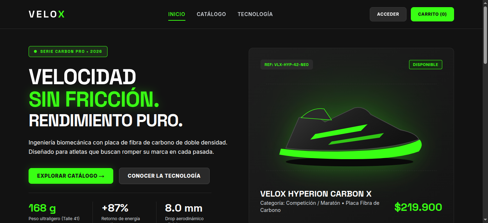 | 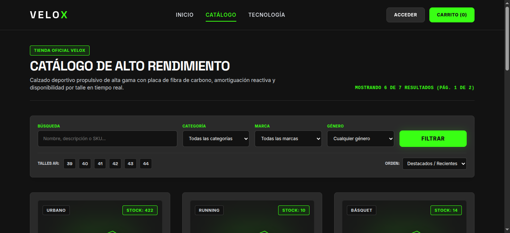 |
| **Ficha Técnica Dinámica con Talles/Stock (`/productos/[id]`)** | **Bolsa de Compras y Checkout con Zod (`/carrito`)** |
| 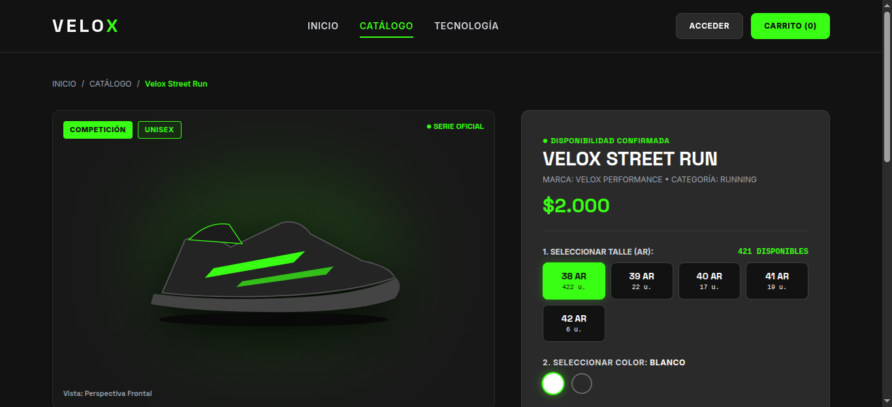 | 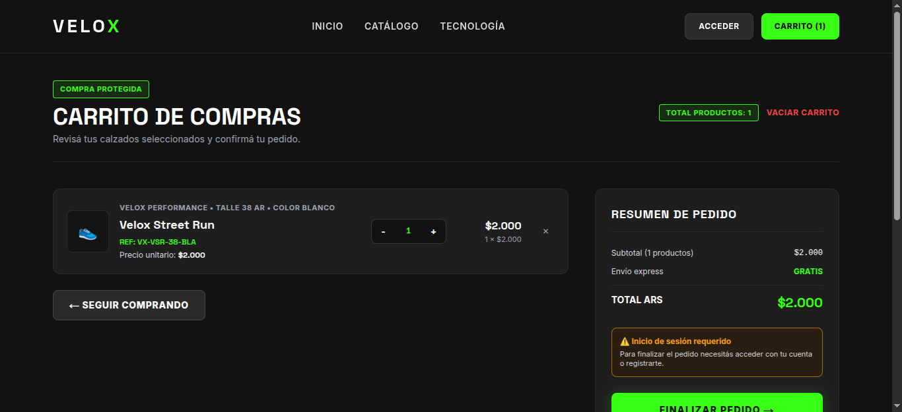 |
| **Inicio de Sesión JWT (`/login`)** | **Registro de Nuevos Clientes (`/register`)** |
| 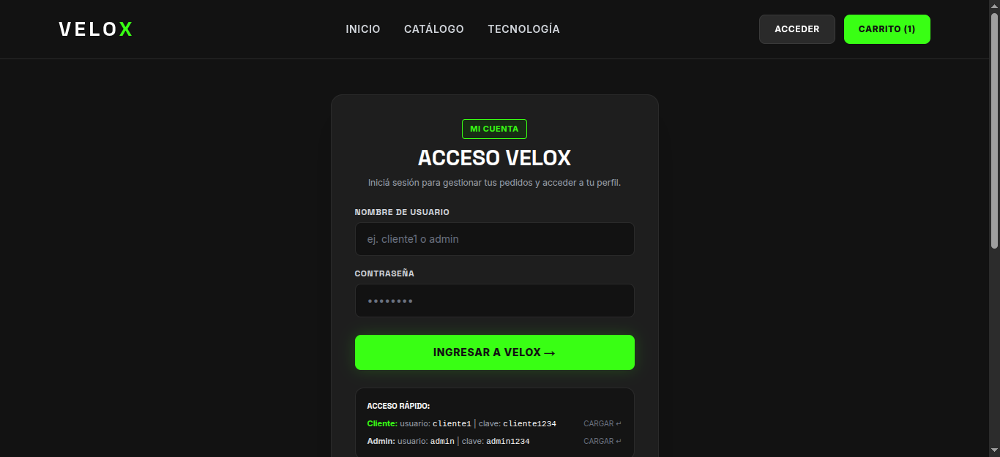 | 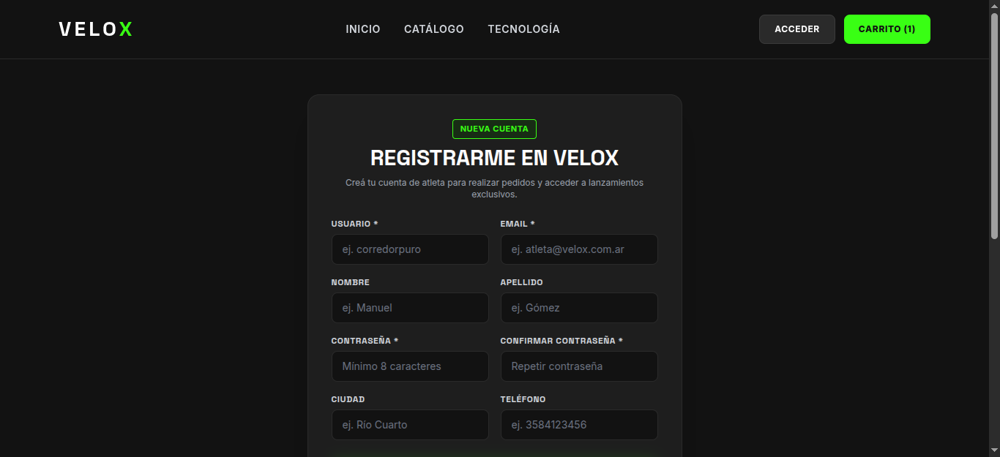 |
| **Panel Administrativo KPIs (`/dashboard`)** | **Módulo CRUD de Inventario y Reseñas (`/dashboard`)** |
| 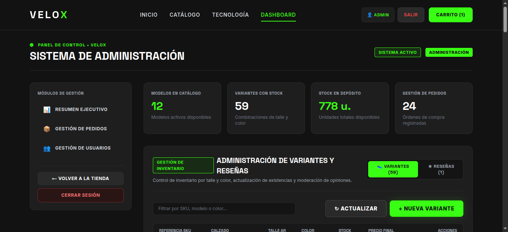 | 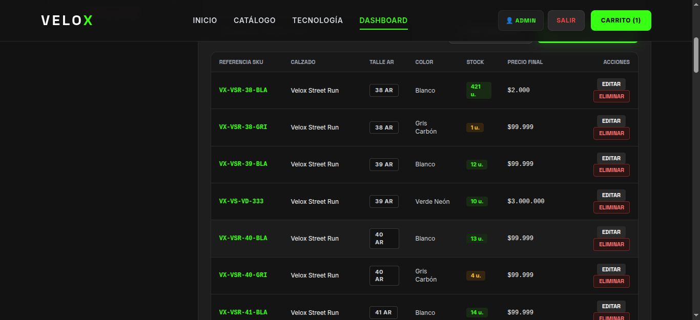 |
| **Monitoreo Reactivo de Pedidos (`/dashboard/pedidos`)** | **Ficha de Pedido y Cancelación Atómica (`/dashboard/pedidos/[id]`)** |
| 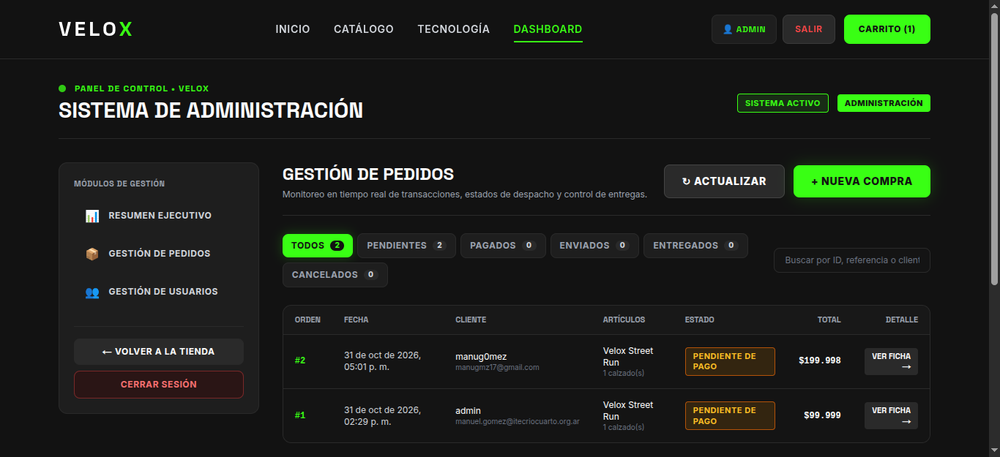 | 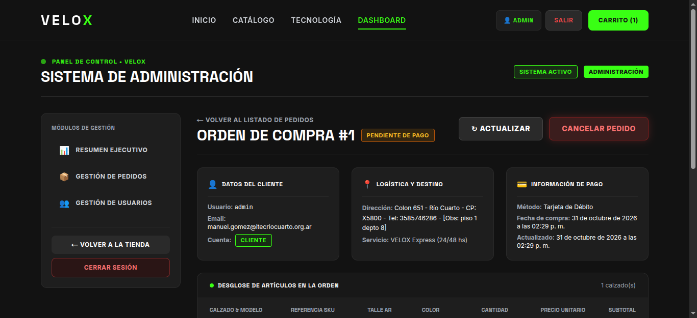 |
| **Gestión de Usuarios y Roles (`/dashboard/usuarios`)** | **Manifiesto Biomecánico e Innovación (`/tecnologia`)** |
| 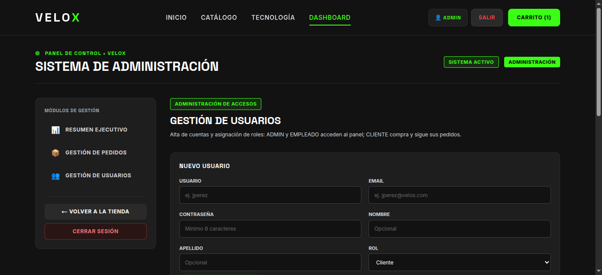 | 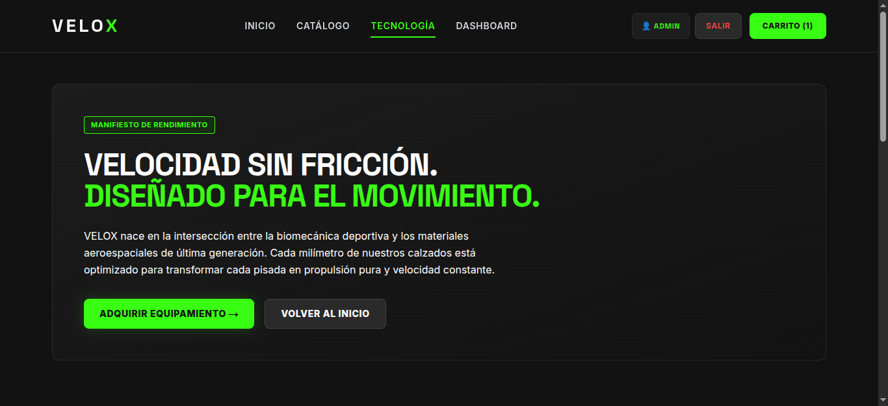 |

---

## ✅ Frontend — Cumplimiento de la Consigna (Programación III)

Auditoría de requisitos obligatorios del Examen Final Integrador realizada sobre el frontend Next.js:

| Requisito | Estado | Evidencia en el Código |
| :--- | :---: | :--- |
| **R1. Enrutamiento y Layouts** (6+ rutas, anidada, 2+ dinámicas, layout anidado, loading/error/not-found) | CUMPLE (12 rutas) | 12 rutas en `src/app/`: `/`, `/tecnologia`, `/productos`, `/productos/[id]`, `/carrito`, `/login`, `/register`, `/mis-pedidos`, `/dashboard`, `/dashboard/pedidos`, `/dashboard/pedidos/[id]`, `/dashboard/usuarios`. Layout anidado en `src/app/dashboard/layout.jsx`. `loading.jsx`, `error.jsx`, `not-found.jsx`. |
| **R2. Arquitectura de Componentes** (8+ componentes reutilizables con justificación Server vs Client) | CUMPLE (12 componentes) | 12 componentes en `src/components/` con comentarios explicativos de paradigma: `DashboardCrudManager`, `PedidoDetalleClient`, `ProductCard`, `FilterBar`, `ProductDetailClient`, `Navbar`, `Footer`, `Button`, `Badge`, `SkeletonCard`, `Modal`, `LogoutButton`. |
| **R3. Integración con la API y CRUD Completo** (4 operaciones CRUD sobre recurso principal, listado con búsqueda y filtros, estados de carga/error) | CUMPLE | Cliente centralizado en `src/lib/api.js`. 4 operaciones CRUD (`GET`, `POST`, `PATCH`, `DELETE`) en `DashboardCrudManager.jsx` sobre variantes de calzado y reseñas. Filtros reactivos y búsqueda sincronizados en `FilterBar.jsx`. |
| **R4. Autenticación** (Login con token JWT, logout, rutas protegidas por sesión y rol) | CUMPLE | `src/app/login/page.jsx`, Server Actions en `src/app/actions.js`, decodificación en `src/lib/jwt.js` y protección perimetral con `src/proxy.js` (rutas `/dashboard` y `/mis-pedidos`). |
| **R5. Formularios y Validaciones** (React Hook Form + Zod, mensajes en español, errores de API) | CUMPLE | Formularios controlados con RHF y resolver Zod en `/login` (`loginSchema`), `/register` (`registerSchema`), `/carrito` (`checkoutFormSchema`) y en `DashboardCrudManager.jsx`. |
| **R6. Estado Global con Context API** (createContext/useContext con persistencia) | CUMPLE | `src/context/CartContext.jsx` con `CartProvider`, `useCart()`, persistencia en `localStorage` (`velox_cart`) y sincronización multi-pestaña con evento `storage`. |
| **R7. Testing Unitario** (Vitest con 4+ tests passing) | CUMPLE (106 tests) | 17 suites de prueba con 106 tests unitarios pasando exitosamente en Vitest (`src/app/__tests__/`). |
| **R8. Despliegue en Producción** (Aplicación desplegada conectada a API pública) | CUMPLE | Desplegado en Vercel: `https://proyecto-velox.vercel.app/` conectado a la API en Render: `https://velox-backend-smxi.onrender.com/api`. |

---

## 🚀 Backend — Puesta en marcha local (`uv`)

Requisitos: Python 3.12+ y [`uv`](https://docs.astral.sh/uv/).

```bash
cd backend
uv sync                                   # crea .venv e instala dependencias desde uv.lock
cd src
uv run python manage.py migrate           # crea la base SQLite (db.sqlite3) con todas las tablas
uv run python manage.py loaddata catalogo_velox   # carga el catálogo de prueba
uv run python manage.py createsuperuser   # usuario para entrar a /admin/
uv run python manage.py runserver         # http://127.0.0.1:8000/admin/
```

**Estructura:** `backend/pyproject.toml` + `uv.lock`, proyecto Django en `backend/src/` (`manage.py`, configuración en `nucleo/`, apps en `apps/usuarios/`, `apps/productos/` y `apps/pedidos/`).

**Tests:** `cd backend/src && uv run python manage.py test` (15 tests de integración).

**Variables de entorno** (opcionales en desarrollo, obligatorias en producción):

| Variable | Valor por defecto | Uso |
| :--- | :--- | :--- |
| `DJANGO_SECRET_KEY` | clave insegura de desarrollo | Clave criptográfica de Django |
| `DJANGO_DEBUG` | `True` | Modo debug (`False` en producción) |
| `DJANGO_ALLOWED_HOSTS` | `localhost,127.0.0.1,0.0.0.0,testserver` | Hosts permitidos (separados por coma) |
| `CORS_ALLOWED_ORIGINS` | `http://localhost:3000,http://127.0.0.1:3000` | Orígenes del frontend Next.js autorizados |
| `DATABASE_URL` | *(vacía → SQLite)* | Conexión PostgreSQL en producción |
| `CSRF_TRUSTED_ORIGINS` | *(vacía)* | Dominios https desde donde se usa `/admin/` |
| `DJANGO_SUPERUSER_USERNAME` / `_EMAIL` / `_PASSWORD` | *(vacías)* | Superusuario creado automáticamente al arrancar en producción |

Plantilla completa en `backend/.env.example`.

### Ejecución con Docker (desarrollo)

```bash
cd backend
docker compose up --build    # http://localhost:8000 — migra, carga el catálogo y levanta runserver
```

**Usuario personalizado:** `apps.usuarios.Usuario` hereda de `AbstractUser` y agrega `rol` (`ADMIN`, `EMPLEADO`, `CLIENTE`), `telefono`, `direccion` y `ciudad`; `email` es único. Está configurado como `AUTH_USER_MODEL` desde la primera migración.

## 🗺️ Backend — Modelo de Datos (Diagrama ER)

12 modelos relacionales normalizados en 3FN (detalle y justificación en `docs/backend/arquitectura_y_dominio.md`):


## 📘 Backend — Documentación de la API

| URL | Contenido |
| :--- | :--- |
| `/api/docs/` | **Swagger UI**: documentación interactiva OpenAPI 3 (`drf-spectacular`); permite probar cada endpoint con el botón *Authorize* (JWT `Bearer`). |
| `/api/redoc/` | **ReDoc**: especificación de lectura de todos los endpoints, parámetros y respuestas. |
| `/api/schema/` | Esquema OpenAPI 3 en YAML (lo consumen Swagger y ReDoc). |
| `/api/` | **API navegable** de Django REST Framework (raíz del router con los 8 ViewSets). |
| `/` | Vista tradicional de bienvenida (template HTML). |
| `/admin/` | Panel de administración de Django. |

El schema se valida sin warnings: `uv run python manage.py spectacular --validate --fail-on-warn --file /dev/null`.

## ☁️ Backend — Deploy Público en Render

**URL pública:** `https://velox-backend-smxi.onrender.com` (Swagger en `https://velox-backend-smxi.onrender.com/api/docs/`)

El deploy está definido como código en `render.yaml` (Blueprint):

| Componente | Configuración |
| :--- | :--- |
| Servicio web `velox-backend` | Docker (`backend/Dockerfile`), plan free, despliega la rama `main` |
| Base de datos `velox-db` | PostgreSQL free, conectada por `DATABASE_URL` |
| Servidor | `gunicorn` (2 workers) — `backend/start.sh` |
| Estáticos | `whitenoise` (admin y API navegable con estilos sin Nginx) |
| Arranque | `migrate` → `cargar_catalogo` (solo si la base está vacía) → superusuario desde variables → `gunicorn` |

**Pasos para desplegar (una sola vez):**
1. Entrar a [render.com](https://render.com) con GitHub → **New → Blueprint** → elegir este repositorio.
2. Completar las variables que pide: `CORS_ALLOWED_ORIGINS` (URL del frontend en producción) y `DJANGO_SUPERUSER_USERNAME` / `_EMAIL` / `_PASSWORD`.
3. **Apply**. Render crea la base, construye la imagen y publica la API. Cada push a `main` redespliega automáticamente.
4. En el frontend, configurar `NEXT_PUBLIC_API_URL=https://<url-de-render>/api` (Requisito R8 de Programación III).

> En el plan gratuito el servicio se suspende tras 15 minutos sin uso: la primera petición después tarda ~50 s. Conviene abrir la URL unos minutos antes de la defensa.

## 📸 Backend — Capturas del Sistema Funcionando

Tomadas con el servidor en modo producción (`DEBUG=False`, PostgreSQL, gunicorn y whitenoise):

| Vista de bienvenida (`/`) | Swagger UI (`/api/docs/`) |
| :---: | :---: |
| 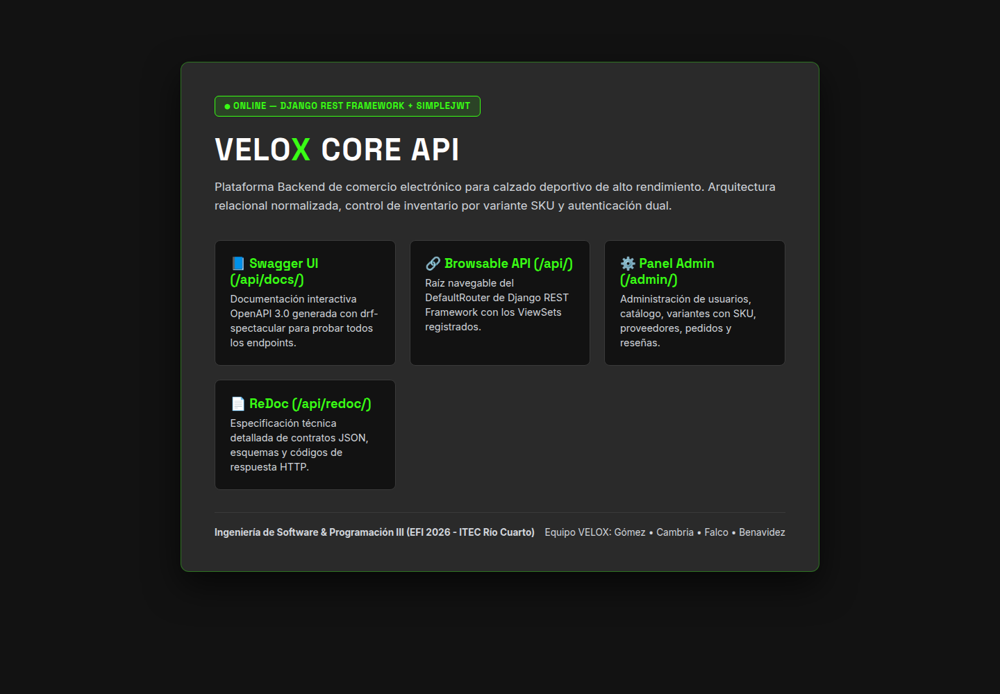 | 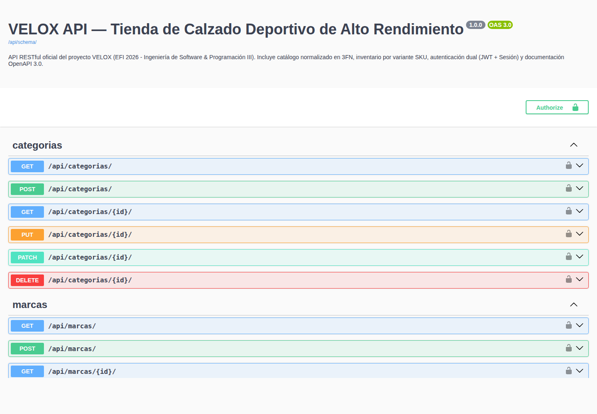 |
| **Listado con NestedSerializer (`/api/productos/`)** | **@action `stock_por_talle`** |
| 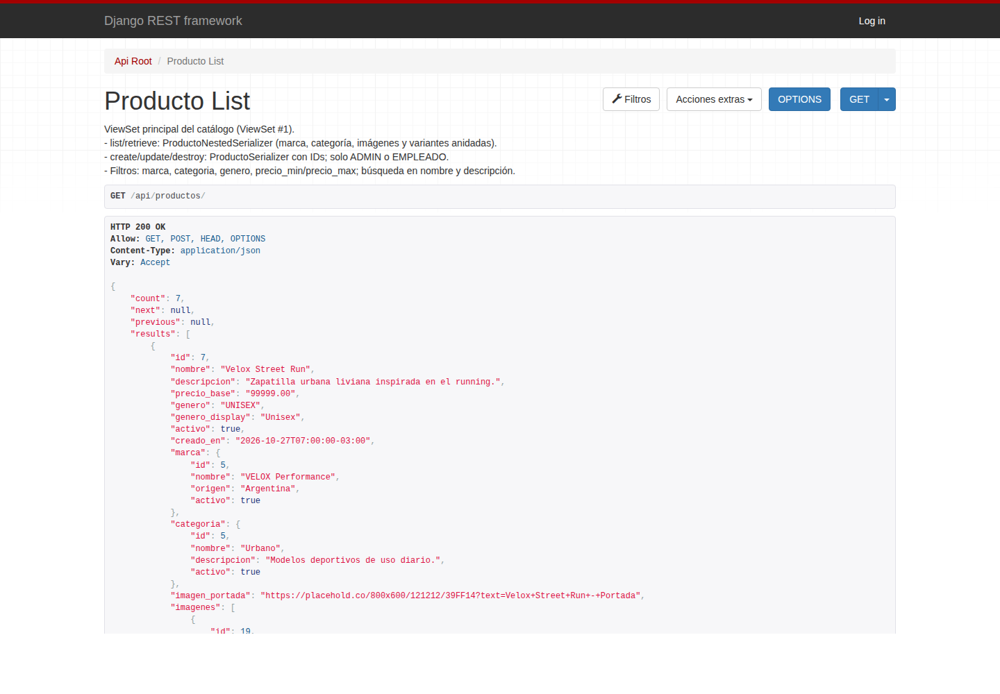 | 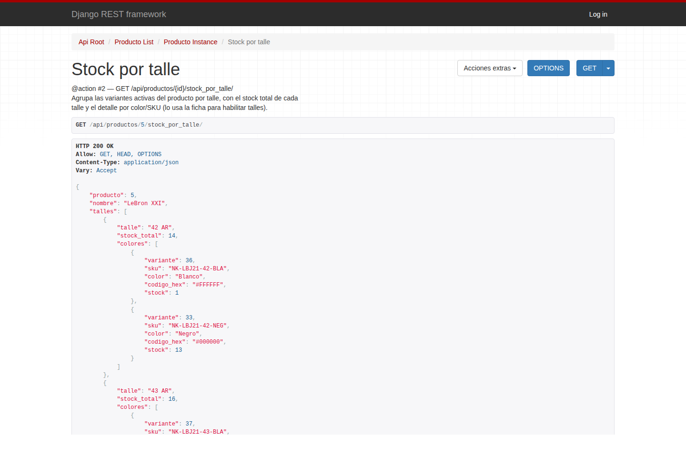 |
| **Filtros django-filter (`?marca=1&ordering=precio_base`)** | |
| 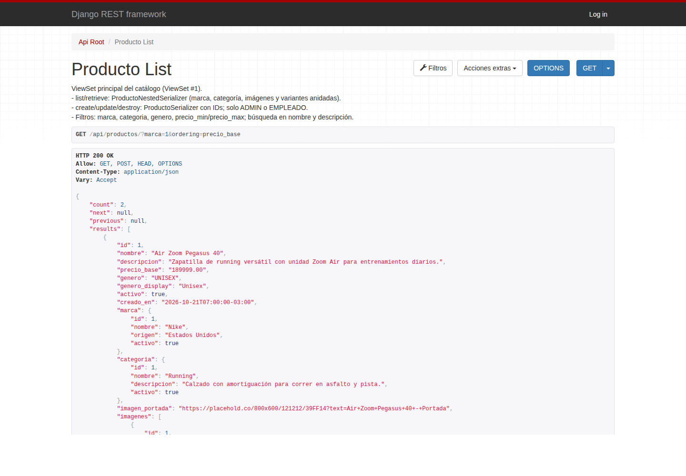 | |

## ✅ Backend — Cumplimiento de la Consigna (Ingeniería de Software)

Auditoría realizada con la skill `auditar-consigna-efi` sobre el código de `backend/`:

| Requisito | Estado | Evidencia |
| :--- | :---: | :--- |
| Mínimo 10 modelos | CUMPLE (12) | `apps/usuarios/models.py`, `apps/productos/models.py`, `apps/pedidos/models.py` |
| `Usuario(AbstractUser)` con `rol` | CUMPLE | `apps/usuarios/models.py` (`AUTH_USER_MODEL`) |
| 8 ViewSets en router | CUMPLE (8) | `nucleo/routers.py`: usuarios, pedidos, resenas, productos, marcas, categorias, variantes, proveedores |
| Paginación en listados | CUMPLE | `REST_FRAMEWORK['DEFAULT_PAGINATION_CLASS']` = `PageNumberPagination` |
| ViewSet con filtros y búsqueda | CUMPLE | `ProductoViewSet` + `apps/productos/filters.py` |
| 2 NestedSerializers en `list` | CUMPLE (2) | `ProductoNestedSerializer`, `PedidoListSerializer` |
| 2 `@action` personalizadas | CUMPLE (4) | `destacados`, `stock_por_talle`, `cancelar_pedido`, `perfil` |
| Autenticación Sesión + JWT | CUMPLE | `REST_FRAMEWORK['DEFAULT_AUTHENTICATION_CLASSES']`, `/api/token/` |
| Swagger / OpenAPI en `/api/docs/` | CUMPLE | `nucleo/urls.py` (Swagger, ReDoc y schema) |
| API navegable | CUMPLE | `/api/` (renderers por defecto de DRF) |
| Vista tradicional en `/` | CUMPLE | `nucleo/views.py` + `templates/inicio.html` |
| `admin.py` configurado | CUMPLE | 11 modelos registrados con `list_display`, `search_fields` y `ordering` (y `list_filter` en todos salvo `Color`); `DetallePedido` se edita como inline del `Pedido` |
| Permisos por rol y CORS | CUMPLE | `apps/*/permissions.py`, `django-cors-headers` |
| `uv` y Docker | CUMPLE | `pyproject.toml`, `uv.lock`, `Dockerfile`, `docker-compose.yml` |
| Deploy público | CUMPLE | Desplegado en producción en Render: `https://velox-backend-smxi.onrender.com/api/` |

## 🗂️ Backend — Catálogo e Inventario (`backend/src/apps/productos/`)

App Django con los **8 modelos del catálogo** (normalizados en 3FN) y su panel de administración:

| Modelo | Campos | Reglas de integridad |
| :--- | :--- | :--- |
| `Marca` | `nombre`, `origen`, `activo` | `nombre` único |
| `Categoria` | `nombre`, `descripcion`, `activo` | `nombre` único |
| `Proveedor` | `razon_social`, `cuit`, `email`, `telefono`, `activo` | `cuit` único con formato `XX-XXXXXXXX-X` |
| `Producto` | `marca`, `categoria`, `proveedor`, `nombre`, `descripcion`, `precio_base`, `genero`, `activo`, `creado_en` | FKs con `PROTECT`; `genero` ∈ `HOMBRE`/`MUJER`/`UNISEX` |
| `Talle` | `numero`, `sistema` | `(numero, sistema)` único; `sistema` ∈ `AR`/`US`/`EU`/`UK` |
| `Color` | `nombre`, `codigo_hex` | `nombre` único; hex `#RRGGBB` |
| `VarianteProducto` | `producto`, `talle`, `color`, `sku`, `stock`, `precio_ajustado`, `activo` | `sku` único; `(producto, talle, color)` único |
| `ImagenProducto` | `producto`, `url`, `es_portada`, `orden` | Máximo una portada por producto |

**Datos de prueba (seed):** `fixtures/catalogo_velox.json` carga 5 marcas, 5 categorías, 3 proveedores, 7 talles, 5 colores, 7 calzados, 58 variantes con SKU y 21 imágenes.

Panel de administración: `/admin/productos/` (los productos permiten cargar variantes e imágenes en la misma ficha; el stock de cada SKU se edita directamente desde el listado de variantes).

### Endpoints del Catálogo (`apps/productos`)

Todos los listados están paginados (`{ count, next, previous, results }`, 10 por página).

| Método | Endpoint | Descripción | Permiso |
| :--- | :--- | :--- | :--- |
| `GET` | `/api/productos/` | Listado con **NestedSerializer #1** (marca, categoría, imágenes, variantes, `imagen_portada` y `stock_total`) | Público |
| `GET` | `/api/productos/{id}/` | Ficha completa del calzado (mismo serializador anidado) | Público |
| `POST / PUT / PATCH / DELETE` | `/api/productos/`, `/api/productos/{id}/` | Alta, edición y baja; las relaciones se envían como IDs (`marca`, `categoria`, `proveedor`) | ADMIN o EMPLEADO |
| `GET` | `/api/productos/destacados/` | **@action #1**: los 6 lanzamientos más recientes con stock | Público |
| `GET` | `/api/productos/{id}/stock_por_talle/` | **@action #2**: stock agrupado por talle con detalle por color y SKU | Público |
| `GET / POST / PUT / PATCH / DELETE` | `/api/marcas/`, `/api/categorias/` | CRUD de marcas y categorías | Lectura pública, escritura ADMIN o EMPLEADO |
| `GET / POST / PUT / PATCH / DELETE` | `/api/variantes/`, `/api/variantes/{sku}/` | Inventario por SKU (se accede por SKU, no por ID) | Lectura pública, escritura ADMIN o EMPLEADO |
| `GET / POST / PUT / PATCH / DELETE` | `/api/proveedores/` | CRUD de proveedores | Solo ADMIN o EMPLEADO |

**Filtros de `/api/productos/`:** `?marca=`, `?categoria=`, `?genero=` (`HOMBRE`/`MUJER`/`UNISEX`), `?precio_min=`, `?precio_max=`, `?search=` (nombre, descripción, marca) y `?ordering=` (`precio_base`, `-creado_en`, `nombre`).

```bash
cd backend/src && uv run python manage.py test apps.productos   # 7 tests de la API de catálogo
```

## 🔐 Backend — Autenticación Dual, Docker y Endpoints de Usuarios (Card #17)

### Endpoints Incorporados (`apps/usuarios` y Núcleo DRF)

| Método | Endpoint | Descripción | Permiso |
| :--- | :--- | :--- | :--- |
| `GET` | `/` | Vista HTML tradicional de bienvenida de **VELOX CORE API** | Público |
| `GET` | `/api/docs/` | Documentación interactiva **Swagger UI** (`drf-spectacular`) | Público |
| `GET` | `/api/redoc/` | Documentación técnica **ReDoc** (OpenAPI 3.0) | Público |
| `POST` | `/api/token/` | Emisión de tokens JWT (`access` y `refresh`) con `SimpleJWT` | Público |
| `POST` | `/api/token/refresh/` | Renovación de token de acceso JWT | Público |
| `POST` | `/api/usuarios/` | Registro público de clientes (`rol="CLIENTE"` por defecto) | Público (`AllowAny`) |
| `GET` | `/api/usuarios/` | Listado paginado de usuarios (filtros por `rol`, `ciudad`, `search`) | Autenticado (`ADMIN`/`EMPLEADO` ven todos; `CLIENTE` ve el propio) |
| `GET / PATCH` | `/api/usuarios/perfil/` | Consulta o edición rápida del perfil del usuario autenticado | Autenticado (JWT / Sesión) |
| `GET / PUT / PATCH / DELETE` | `/api/usuarios/{id}/` | Detalle, actualización y baja de cuenta de usuario | Propietario o `ADMIN` |

## 🛒 Backend — Pedidos, Control de Stock y Reseñas (`backend/src/apps/pedidos/`) (Card #22)

Módulo transaccional con los 3 modelos que completan los **12 modelos relacionales** de VELOX:

| Modelo | Campos Clave | Reglas de Integridad y Negocio |
| :--- | :--- | :--- |
| `Pedido` | `usuario`, `fecha_creacion`, `estado`, `metodo_pago`, `direccion_envio`, `total` | Estados: `PENDIENTE`, `PAGADO`, `ENVIADO`, `ENTREGADO`, `CANCELADO`. Métodos de pago: crédito, débito, transferencia, efectivo. |
| `DetallePedido` | `pedido`, `variante`, `cantidad`, `precio_unitario`, `subtotal` | Vinculado a `VarianteProducto` (`PROTECT`) y `Pedido` (`CASCADE`). Congela el precio unitario en la compra. |
| `Resena` | `usuario`, `producto`, `calificacion`, `comentario`, `creado_en` | Calificación de 1 a 5 estrellas. Restricción única: un usuario solo puede calificar un producto una vez. |

### Endpoints Incorporados (`apps/pedidos`)

| Método | Endpoint | Descripción | Permiso |
| :--- | :--- | :--- | :--- |
| `POST` | `/api/pedidos/` | Creación de pedido (Checkout) con **descuento atómico de stock** (`select_for_update`) | Autenticado |
| `GET` | `/api/pedidos/` | Listado paginado de pedidos con **NestedSerializer #2** (anida datos del usuario y detalles con SKU) | Autenticado (Clientes ven solo los propios; Admin/Empleado ven todos) |
| `GET` | `/api/pedidos/{id}/` | Detalle completo de orden de compra | Propietario o Staff |
| `POST` | `/api/pedidos/{id}/cancelar_pedido/` | **Acción personalizada (@action #3)**: cancela el pedido y **restituye el stock** automáticamente a cada variante | Propietario o Staff |
| `GET` | `/api/resenas/` | Listado de valoraciones de calzado (filtrado por `?producto=&calificacion=`) | Público |
| `POST` | `/api/resenas/` | Publicación de reseña (asigna autor automáticamente y valida unicidad) | Autenticado |
| `GET / PUT / PATCH / DELETE` | `/api/resenas/{id}/` | Consulta, edición y baja de reseña | Propietario o Admin |
