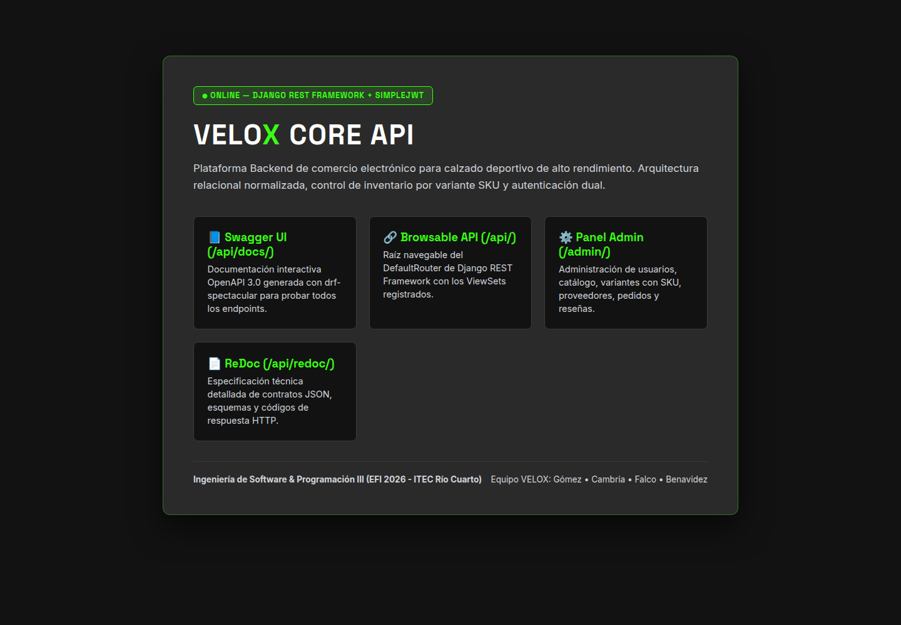
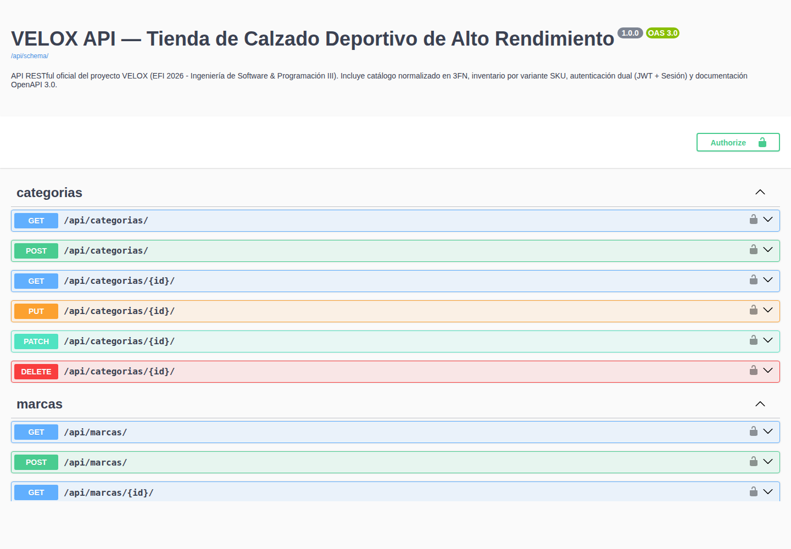
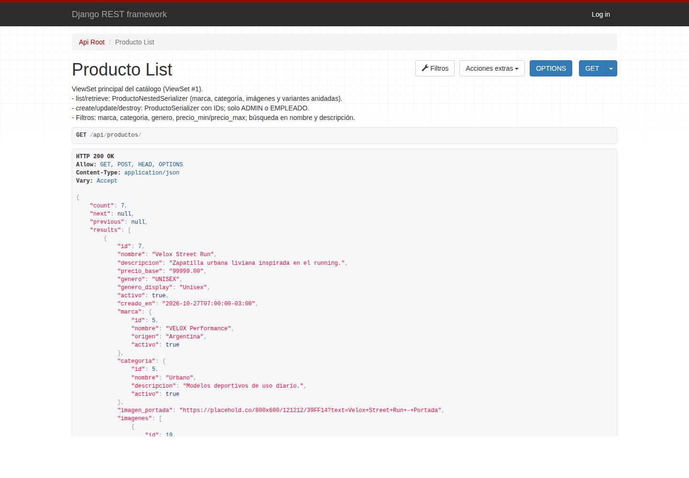
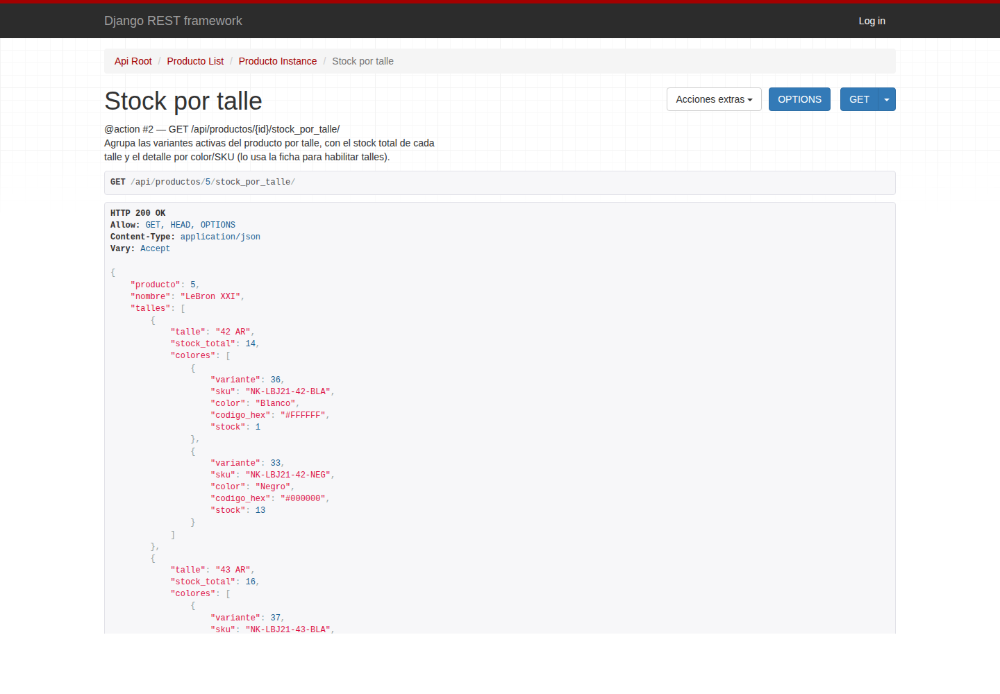
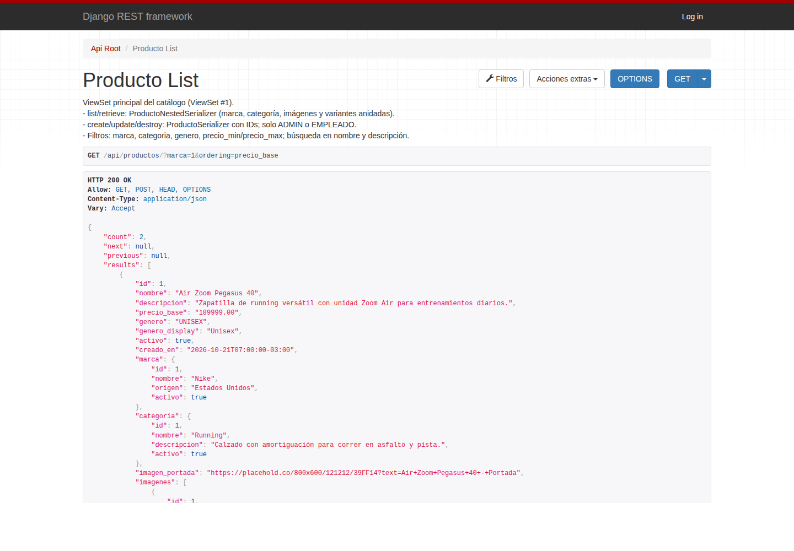

# ⚡ VELOX — E-Commerce de Calzado Deportivo de Alto Rendimiento (EFI 2026)

Repositorio oficial del Examen Final Integrador (EFI 2026) — **ITEC Río Cuarto**:
- **Ingeniería de Software (Backend Django 6 + DRF)** — Prof. Facundo Lemo
- **Programación III (Frontend Next.js App Router)** — Prof. Valentino Arballo

## 👥 Integrantes del Equipo
- **Manuel Gómez** — Backend 1 (Core, Usuarios, Auth Dual JWT/Session, Pedidos, Reseñas y Deploy)
- **Valentino Cambria** — Backend 2 (Catálogo de 8 Modelos, Variantes SKU, ViewSets y Filtros)
- **Juan Falco** — Frontend 1 (UI Kit VELOX, Home, Catálogo, Ficha Dinámica y Autenticación JWT)
- **Tomás Benavidez** — Frontend 2 (CartContext, Schemas Zod, Checkout, Dashboard CRUD y Tests Vitest)

## 📂 Estructura del Monorepo
- `backend/`: API RESTful en Django + Django REST Framework gestionada con `uv` y Docker.
- `frontend/`: Aplicación web en Next.js 16 (App Router) + React 19 + Tailwind CSS v4.
- `docs/`: Documentación de arquitectura, manual de marca VELOX, plantillas de Figma y bitácora de defensa.

---

## ⚛️ Ejecución y Configuración del Frontend (`frontend/`)

### 1. Variables de Entorno
Copiar el archivo `.env.example` hacia `.env.local` dentro de `frontend/`:

```bash
cd frontend
cp .env.example .env.local
```

Variables requeridas:
- `NEXT_PUBLIC_API_URL=http://localhost:8000/api` (URL base del Backend en Django REST Framework).

### 2. Instalación y Servidor de Desarrollo
```bash
cd frontend
npm install
npm run dev
```
La aplicación estará disponible en `http://localhost:3000`.

### 3. Rutas y Componentes Implementados (Sprint 1 & Sprint 2)
- **Rutas y Layouts (R1):**
  - `/` (`src/app/page.jsx`): Landing Page y Hero Section con resplandor verde neón (`#39FF14`) y consumo de `GET /api/productos/destacados/` con fallback seguro.
  - `/tecnologia` (`src/app/tecnologia/page.jsx`): Manifiesto técnico e ingeniería biomecánica VELOX.
  - `/productos` (`src/app/productos/page.jsx`): Catálogo general paginado con Server Component que procesa el sobre paginado de DRF (`{ count, next, previous, results }`), sincronización bidireccional con query params y fallback completo en memoria.
  - `/productos/[id]` (`src/app/productos/[id]/page.jsx`): Ficha técnica dinámica de calzado deportivo con Server Component para SEO y metadata, e hidratación de `ProductDetailClient.jsx` para galería interactiva de fotos (1:N), selector de talles AR y colores SKU con verificación de stock en tiempo real y módulo de reseñas de atletas.
  - `/dashboard` (`src/app/dashboard/layout.jsx` y `page.jsx`): Layout anidado y panel administrativo con KPIs en tiempo real del catálogo y variantes SKU.
  - `/login` (`src/app/login/page.jsx`): Formulario interactivo con React Hook Form + Zod (`authSchema.js`) y manejo estructurado de errores DRF.
  - `/carrito` (`src/app/carrito/page.jsx`): Carrito de compras interactivo conectado al estado global `CartContext` y al endpoint transaccional real `POST /api/pedidos/` de Django REST Framework con autenticación JWT (`Authorization: Bearer <token>`), selector de cantidades, botón rápido con variantes reales del catálogo (IDs 54, 49, 55, 44 del fixture), validación RHF + Zod (`checkoutFormSchema` y `orderSchema`), modal de orden confirmada con datos devueltos por DRF y captura de errores estructurados (stock insuficiente 400 y sesión expirada 401).
  - Estados globales App Router: `src/app/layout.jsx` (Layout raíz con `CartProvider`), `src/app/loading.jsx`, `src/app/error.jsx` y `src/app/not-found.jsx`.
- **Componentes Reutilizables Base (R2):**
  - `src/components/ProductCard.jsx` (`Client Component` — tarjeta de producto con selector de talle AR interactivo en vivo, recálculo de SKU/precio y compra directa a `CartContext`)
  - `src/components/FilterBar.jsx` (`Client Component` — barra de filtrado declarativa por búsqueda, marca, categoría, género, pills de talles AR y ordenamiento sincronizada con la URL)
  - `src/components/ProductDetailClient.jsx` (`Client Component` — isla interactiva de ficha técnica con galería de fotos, variantes SKU, stock y reseñas)
  - `src/components/Navbar.jsx` (`Client Component` — sincronizado reactivamente con `useCart()`)
  - `src/components/Footer.jsx` (`Server Component`)
  - `src/components/Button.jsx` (`Client Component`)
  - `src/components/Badge.jsx` (`Server Component`)
  - `src/components/SkeletonCard.jsx` (`Server Component`)
  - `src/components/Modal.jsx` (`Client Component` — accesibilidad con tecla Escape, clic en backdrop y bloqueo de scroll)
- **Estado Global con Context API (R6):**
  - `src/context/CartContext.jsx`: Proveedor `CartProvider` y hook `useCart()` con métodos `addToCart()`, `removeFromCart()`, `updateQuantity()`, `clearCart()`, preservación de `variante_id`, totales memorizados y persistencia bidireccional en `localStorage` (`velox_cart`) con soporte de sincronización multi-pestaña vía evento `storage`.
- **Validaciones Zod en `snake_case` (R5):**
  - `src/validations/authSchema.js`: Esquemas `loginSchema` y `registerSchema` alineados a `RegistroUsuarioSerializer`.
  - `src/validations/orderSchema.js`: Esquemas `checkoutFormSchema`, `checkoutSchema` y `orderItemSchema` alineados exactamente a `Pedido.MetodoPago` (`TARJETA_CREDITO`, `TARJETA_DEBITO`, `TRANSFERENCIA`, `EFECTIVO`) y `PedidoCreateSerializer`.
- **Cliente API REST (R3):**
  - `src/lib/api.js`: Helper de peticiones HTTP con soporte para el sobre paginado de DRF `{ count, next, previous, results }`, clase `ApiError` y métodos CRUD completos (`get`, `getPaginated`, `post`, `put`, `patch`, `delete`).

### 4. Ejecución de Tests Unitarios (R7)
Ejecutar la suite completa de tests unitarios en Vitest con Testing Library y JSDOM:
```bash
cd frontend
npm run test
```
*Cobertura: 7 suites de prueba y 54 tests unitarios verificando `CartContext` (incluyendo sincronización multi-pestaña y preservación de `variante_id`), esquemas de Zod (`authSchema`, `orderSchema` con opciones de pago oficiales y validación estricta de SKU/variante), normalización, métodos CRUD y formateo recursivo de errores anidados DRF en `api.js`, componente `Modal`, componente `ProductCard` (renderizado, selector dinámico de talles AR, stock y despacho al carrito) y flujo completo de checkout interactivo conectado a DRF con autenticación JWT, descuento de stock y manejo de errores 400/401.*
## 🚀 Backend — Puesta en marcha local (`uv`)

Requisitos: Python 3.12+ y [`uv`](https://docs.astral.sh/uv/).

```bash
cd backend
uv sync                                   # crea .venv e instala dependencias desde uv.lock
cd src
uv run python manage.py migrate           # crea la base SQLite (db.sqlite3) con todas las tablas
uv run python manage.py loaddata catalogo_velox   # carga el catálogo de prueba
uv run python manage.py createsuperuser   # usuario para entrar a /admin/
uv run python manage.py runserver         # http://127.0.0.1:8000/admin/
```

**Estructura:** `backend/pyproject.toml` + `uv.lock`, proyecto Django en `backend/src/` (`manage.py`, configuración en `nucleo/`, apps en `apps/usuarios/`, `apps/productos/` y `apps/pedidos/`).

**Tests:** `cd backend/src && uv run python manage.py test` (15 tests de integración).

**Variables de entorno** (opcionales en desarrollo, obligatorias en producción):

| Variable | Valor por defecto | Uso |
| :--- | :--- | :--- |
| `DJANGO_SECRET_KEY` | clave insegura de desarrollo | Clave criptográfica de Django |
| `DJANGO_DEBUG` | `True` | Modo debug (`False` en producción) |
| `DJANGO_ALLOWED_HOSTS` | `localhost,127.0.0.1,0.0.0.0,testserver` | Hosts permitidos (separados por coma) |
| `CORS_ALLOWED_ORIGINS` | `http://localhost:3000,http://127.0.0.1:3000` | Orígenes del frontend Next.js autorizados |
| `DATABASE_URL` | *(vacía → SQLite)* | Conexión PostgreSQL en producción |
| `CSRF_TRUSTED_ORIGINS` | *(vacía)* | Dominios https desde donde se usa `/admin/` |
| `DJANGO_SUPERUSER_USERNAME` / `_EMAIL` / `_PASSWORD` | *(vacías)* | Superusuario creado automáticamente al arrancar en producción |

Plantilla completa en `backend/.env.example`.

### Ejecución con Docker (desarrollo)

```bash
cd backend
docker compose up --build    # http://localhost:8000 — migra, carga el catálogo y levanta runserver
```

**Usuario personalizado:** `apps.usuarios.Usuario` hereda de `AbstractUser` y agrega `rol` (`ADMIN`, `EMPLEADO`, `CLIENTE`), `telefono`, `direccion` y `ciudad`; `email` es único. Está configurado como `AUTH_USER_MODEL` desde la primera migración.

## 🗺️ Backend — Modelo de Datos (Diagrama ER)

12 modelos relacionales normalizados en 3FN (detalle y justificación en `docs/backend/arquitectura_y_dominio.md`):


## 📘 Backend — Documentación de la API

| URL | Contenido |
| :--- | :--- |
| `/api/docs/` | **Swagger UI**: documentación interactiva OpenAPI 3 (`drf-spectacular`); permite probar cada endpoint con el botón *Authorize* (JWT `Bearer`). |
| `/api/redoc/` | **ReDoc**: especificación de lectura de todos los endpoints, parámetros y respuestas. |
| `/api/schema/` | Esquema OpenAPI 3 en YAML (lo consumen Swagger y ReDoc). |
| `/api/` | **API navegable** de Django REST Framework (raíz del router con los 8 ViewSets). |
| `/` | Vista tradicional de bienvenida (template HTML). |
| `/admin/` | Panel de administración de Django. |

El schema se valida sin warnings: `uv run python manage.py spectacular --validate --fail-on-warn --file /dev/null`.

## ☁️ Backend — Deploy Público en Render

**URL pública:** `https://velox-backend.onrender.com` *(completar con la URL asignada por Render)*

El deploy está definido como código en `render.yaml` (Blueprint):

| Componente | Configuración |
| :--- | :--- |
| Servicio web `velox-backend` | Docker (`backend/Dockerfile`), plan free, despliega la rama `main` |
| Base de datos `velox-db` | PostgreSQL free, conectada por `DATABASE_URL` |
| Servidor | `gunicorn` (2 workers) — `backend/start.sh` |
| Estáticos | `whitenoise` (admin y API navegable con estilos sin Nginx) |
| Arranque | `migrate` → `cargar_catalogo` (solo si la base está vacía) → superusuario desde variables → `gunicorn` |

**Pasos para desplegar (una sola vez):**
1. Entrar a [render.com](https://render.com) con GitHub → **New → Blueprint** → elegir este repositorio.
2. Completar las variables que pide: `CORS_ALLOWED_ORIGINS` (URL del frontend en producción) y `DJANGO_SUPERUSER_USERNAME` / `_EMAIL` / `_PASSWORD`.
3. **Apply**. Render crea la base, construye la imagen y publica la API. Cada push a `main` redespliega automáticamente.
4. En el frontend, configurar `NEXT_PUBLIC_API_URL=https://<url-de-render>/api` (Requisito R8 de Programación III).

> En el plan gratuito el servicio se suspende tras 15 minutos sin uso: la primera petición después tarda ~50 s. Conviene abrir la URL unos minutos antes de la defensa.

## 📸 Backend — Capturas del Sistema Funcionando

Tomadas con el servidor en modo producción (`DEBUG=False`, PostgreSQL, gunicorn y whitenoise):

| Vista de bienvenida (`/`) | Swagger UI (`/api/docs/`) |
| :---: | :---: |
|  |  |
| **Listado con NestedSerializer (`/api/productos/`)** | **@action `stock_por_talle`** |
|  |  |
| **Filtros django-filter (`?marca=1&ordering=precio_base`)** | |
|  | |

## ✅ Backend — Cumplimiento de la Consigna (Ingeniería de Software)

Auditoría realizada con la skill `auditar-consigna-efi` sobre el código de `backend/`:

| Requisito | Estado | Evidencia |
| :--- | :---: | :--- |
| Mínimo 10 modelos | CUMPLE (12) | `apps/usuarios/models.py`, `apps/productos/models.py`, `apps/pedidos/models.py` |
| `Usuario(AbstractUser)` con `rol` | CUMPLE | `apps/usuarios/models.py` (`AUTH_USER_MODEL`) |
| 8 ViewSets en router | CUMPLE (8) | `nucleo/routers.py`: usuarios, pedidos, resenas, productos, marcas, categorias, variantes, proveedores |
| Paginación en listados | CUMPLE | `REST_FRAMEWORK['DEFAULT_PAGINATION_CLASS']` = `PageNumberPagination` |
| ViewSet con filtros y búsqueda | CUMPLE | `ProductoViewSet` + `apps/productos/filters.py` |
| 2 NestedSerializers en `list` | CUMPLE (2) | `ProductoNestedSerializer`, `PedidoListSerializer` |
| 2 `@action` personalizadas | CUMPLE (4) | `destacados`, `stock_por_talle`, `cancelar_pedido`, `perfil` |
| Autenticación Sesión + JWT | CUMPLE | `REST_FRAMEWORK['DEFAULT_AUTHENTICATION_CLASSES']`, `/api/token/` |
| Swagger / OpenAPI en `/api/docs/` | CUMPLE | `nucleo/urls.py` (Swagger, ReDoc y schema) |
| API navegable | CUMPLE | `/api/` (renderers por defecto de DRF) |
| Vista tradicional en `/` | CUMPLE | `nucleo/views.py` + `templates/inicio.html` |
| `admin.py` configurado | CUMPLE | 11 modelos registrados con `list_display`, `search_fields` y `ordering` (y `list_filter` en todos salvo `Color`); `DetallePedido` se edita como inline del `Pedido` |
| Permisos por rol y CORS | CUMPLE | `apps/*/permissions.py`, `django-cors-headers` |
| `uv` y Docker | CUMPLE | `pyproject.toml`, `uv.lock`, `Dockerfile`, `docker-compose.yml` |
| Deploy público | PENDIENTE | Configurado en `render.yaml`; falta crear el servicio en Render y completar la URL |

## 🗂️ Backend — Catálogo e Inventario (`backend/src/apps/productos/`)

App Django con los **8 modelos del catálogo** (normalizados en 3FN) y su panel de administración:

| Modelo | Campos | Reglas de integridad |
| :--- | :--- | :--- |
| `Marca` | `nombre`, `origen`, `activo` | `nombre` único |
| `Categoria` | `nombre`, `descripcion`, `activo` | `nombre` único |
| `Proveedor` | `razon_social`, `cuit`, `email`, `telefono`, `activo` | `cuit` único con formato `XX-XXXXXXXX-X` |
| `Producto` | `marca`, `categoria`, `proveedor`, `nombre`, `descripcion`, `precio_base`, `genero`, `activo`, `creado_en` | FKs con `PROTECT`; `genero` ∈ `HOMBRE`/`MUJER`/`UNISEX` |
| `Talle` | `numero`, `sistema` | `(numero, sistema)` único; `sistema` ∈ `AR`/`US`/`EU`/`UK` |
| `Color` | `nombre`, `codigo_hex` | `nombre` único; hex `#RRGGBB` |
| `VarianteProducto` | `producto`, `talle`, `color`, `sku`, `stock`, `precio_ajustado`, `activo` | `sku` único; `(producto, talle, color)` único |
| `ImagenProducto` | `producto`, `url`, `es_portada`, `orden` | Máximo una portada por producto |

**Datos de prueba (seed):** `fixtures/catalogo_velox.json` carga 5 marcas, 5 categorías, 3 proveedores, 7 talles, 5 colores, 7 calzados, 58 variantes con SKU y 21 imágenes.

Panel de administración: `/admin/productos/` (los productos permiten cargar variantes e imágenes en la misma ficha; el stock de cada SKU se edita directamente desde el listado de variantes).


### Endpoints del Catálogo (`apps/productos`)

Todos los listados están paginados (`{ count, next, previous, results }`, 10 por página).

| Método | Endpoint | Descripción | Permiso |
| :--- | :--- | :--- | :--- |
| `GET` | `/api/productos/` | Listado con **NestedSerializer #1** (marca, categoría, imágenes, variantes, `imagen_portada` y `stock_total`) | Público |
| `GET` | `/api/productos/{id}/` | Ficha completa del calzado (mismo serializador anidado) | Público |
| `POST / PUT / PATCH / DELETE` | `/api/productos/`, `/api/productos/{id}/` | Alta, edición y baja; las relaciones se envían como IDs (`marca`, `categoria`, `proveedor`) | ADMIN o EMPLEADO |
| `GET` | `/api/productos/destacados/` | **@action #1**: los 6 lanzamientos más recientes con stock | Público |
| `GET` | `/api/productos/{id}/stock_por_talle/` | **@action #2**: stock agrupado por talle con detalle por color y SKU | Público |
| `GET / POST / PUT / PATCH / DELETE` | `/api/marcas/`, `/api/categorias/` | CRUD de marcas y categorías | Lectura pública, escritura ADMIN o EMPLEADO |
| `GET / POST / PUT / PATCH / DELETE` | `/api/variantes/`, `/api/variantes/{sku}/` | Inventario por SKU (se accede por SKU, no por ID) | Lectura pública, escritura ADMIN o EMPLEADO |
| `GET / POST / PUT / PATCH / DELETE` | `/api/proveedores/` | CRUD de proveedores | Solo ADMIN o EMPLEADO |

**Filtros de `/api/productos/`:** `?marca=`, `?categoria=`, `?genero=` (`HOMBRE`/`MUJER`/`UNISEX`), `?precio_min=`, `?precio_max=`, `?search=` (nombre, descripción, marca) y `?ordering=` (`precio_base`, `-creado_en`, `nombre`).

```bash
cd backend/src && uv run python manage.py test apps.productos   # 7 tests de la API de catálogo
```

## 🔐 Backend — Autenticación Dual, Docker y Endpoints de Usuarios (Card #17)

### Endpoints Incorporados (`apps/usuarios` y Núcleo DRF)

| Método | Endpoint | Descripción | Permiso |
| :--- | :--- | :--- | :--- |
| `GET` | `/` | Vista HTML tradicional de bienvenida de **VELOX CORE API** | Público |
| `GET` | `/api/docs/` | Documentación interactiva **Swagger UI** (`drf-spectacular`) | Público |
| `GET` | `/api/redoc/` | Documentación técnica **ReDoc** (OpenAPI 3.0) | Público |
| `POST` | `/api/token/` | Emisión de tokens JWT (`access` y `refresh`) con `SimpleJWT` | Público |
| `POST` | `/api/token/refresh/` | Renovación de token de acceso JWT | Público |
| `POST` | `/api/usuarios/` | Registro público de clientes (`rol="CLIENTE"` por defecto) | Público (`AllowAny`) |
| `GET` | `/api/usuarios/` | Listado paginado de usuarios (filtros por `rol`, `ciudad`, `search`) | Autenticado (`ADMIN`/`EMPLEADO` ven todos; `CLIENTE` ve el propio) |
| `GET / PATCH` | `/api/usuarios/perfil/` | Consulta o edición rápida del perfil del usuario autenticado | Autenticado (JWT / Sesión) |
| `GET / PUT / PATCH / DELETE` | `/api/usuarios/{id}/` | Detalle, actualización y baja de cuenta de usuario | Propietario o `ADMIN` |

## 🛒 Backend — Pedidos, Control de Stock y Reseñas (`backend/src/apps/pedidos/`) (Card #22)

Módulo transaccional con los 3 modelos que completan los **12 modelos relacionales** de VELOX:

| Modelo | Campos Clave | Reglas de Integridad y Negocio |
| :--- | :--- | :--- |
| `Pedido` | `usuario`, `fecha_creacion`, `estado`, `metodo_pago`, `direccion_envio`, `total` | Estados: `PENDIENTE`, `PAGADO`, `ENVIADO`, `ENTREGADO`, `CANCELADO`. Métodos de pago: crédito, débito, transferencia, efectivo. |
| `DetallePedido` | `pedido`, `variante`, `cantidad`, `precio_unitario`, `subtotal` | Vinculado a `VarianteProducto` (`PROTECT`) y `Pedido` (`CASCADE`). Congela el precio unitario en la compra. |
| `Resena` | `usuario`, `producto`, `calificacion`, `comentario`, `creado_en` | Calificación de 1 a 5 estrellas. Restricción única: un usuario solo puede calificar un producto una vez. |

### Endpoints Incorporados (`apps/pedidos`)

| Método | Endpoint | Descripción | Permiso |
| :--- | :--- | :--- | :--- |
| `POST` | `/api/pedidos/` | Creación de pedido (Checkout) con **descuento atómico de stock** (`select_for_update`) | Autenticado |
| `GET` | `/api/pedidos/` | Listado paginado de pedidos con **NestedSerializer #2** (anida datos del usuario y detalles con SKU) | Autenticado (Clientes ven solo los propios; Admin/Empleado ven todos) |
| `GET` | `/api/pedidos/{id}/` | Detalle completo de orden de compra | Propietario o Staff |
| `POST` | `/api/pedidos/{id}/cancelar_pedido/` | **Acción personalizada (@action #3)**: cancela el pedido y **restituye el stock** automáticamente a cada variante | Propietario o Staff |
| `GET` | `/api/resenas/` | Listado de valoraciones de calzado (filtrado por `?producto=&calificacion=`) | Público |
| `POST` | `/api/resenas/` | Publicación de reseña (asigna autor automáticamente y valida unicidad) | Autenticado |
| `GET / PUT / PATCH / DELETE` | `/api/resenas/{id}/` | Consulta, edición y baja de reseña | Propietario o Admin |
