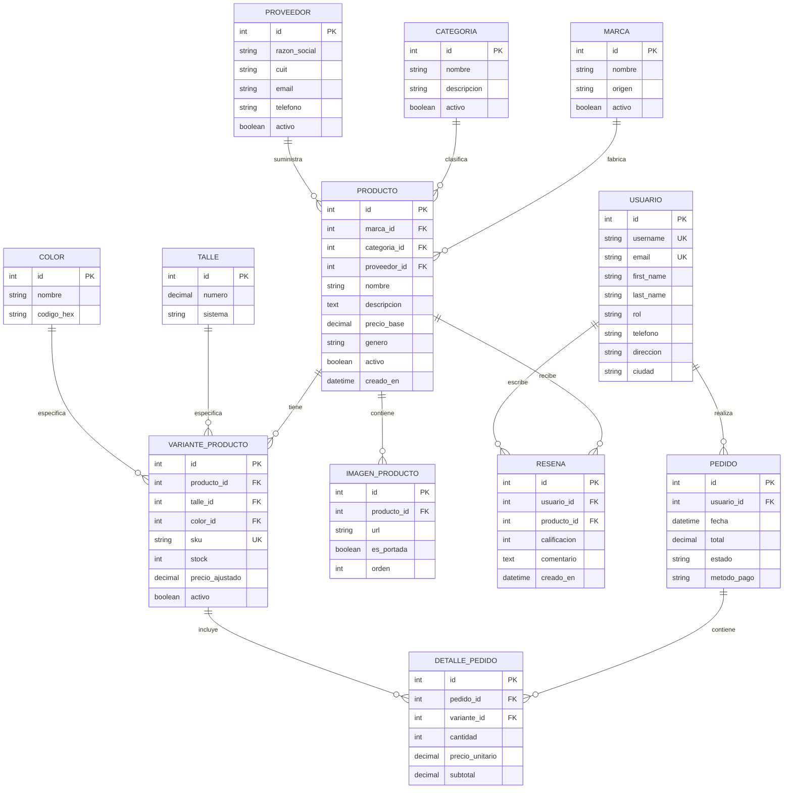

# Arquitectura y Diseño de Dominio: Tienda de Calzado Deportivo

**Espacio curricular:** Ingeniería de Software (EFI 2026)  
**Institución:** Instituto Tecnológico Río Cuarto (ITEC)  
**Docente:** Facundo Esteban Lemo  
**Tecnologías:** Python 3.12+, Django 6.x, Django REST Framework, SimpleJWT, `drf-spectacular`, `uv`, Docker.

---

> [!NOTE]
> **Carácter de la propuesta y flexibilidad:** La estructura de entidades, relaciones y ViewSets descrita en este documento es una **sugerencia de referencia técnica** formulada para garantizar el cumplimiento de los mínimos exigidos por la consigna. No es un esquema cerrado: durante la etapa de planificación formal del proyecto, el equipo podrá incorporar más tablas, atributos, relaciones o endpoints según sea necesario para la organización y alcance del sistema.

## 1. Justificación de Decisiones de Diseño

### A. Dominio e Identidad
El proyecto modela una **Tienda de Calzado Deportivo especializada**. Este dominio permite estructurar un modelo de datos robusto, altamente normalizado y con relaciones reales de negocio (marcas, categorías, variantes físicas por talle y color, stock centralizado, ventas y reseñas).

### B. Custom User Model (`Usuario`) y Gestión de Roles
En lugar de depender del modelo por defecto `django.contrib.auth.models.User` o crear entidades desconectadas, se implementa un modelo de usuario personalizado heredando de `AbstractUser`:
- **Roles unificados:** `ADMINISTRADOR`, `EMPLEADO` y `CLIENTE`.
- **Ventajas:**
  - Evita joins adicionales (`OneToOneField`) para consultar permisos o roles (`request.user.rol`).
  - Permite definir políticas de autorización limpias en DRF (`BasePermission`), restringiendo la modificación de stock o visualización de costos a roles autorizados (`ADMINISTRADOR` o `EMPLEADO`), mientras que `CLIENTE` solo accede al catálogo y a sus propios pedidos.
  - Sigue la recomendación oficial de Django: configurar un modelo de usuario personalizado desde la primera migración.

### C. Desacople de Catálogo e Inventario: `PRODUCTO` vs. `VARIANTE_PRODUCTO`
- **`PRODUCTO`:** Representa el modelo comercial abstracto (ej. *Nike Air Zoom Pegasus 40*, descripción, marca, categoría, precio base).
- **`VARIANTE_PRODUCTO`:** Representa la unidad física real disponible para la venta en el depósito.
  - Combina: `Producto` + `Talle` + `Color`.
  - Mantiene su propio stock independiente y precio ajustado (si aplicase).
- **`SKU` (Stock Keeping Unit):** Código alfanumérico único por variante (ej. `NK-PEG40-41-NEG`). Identifica de manera unívoca el artículo en el inventario, impidiendo duplicados y permitiendo búsquedas operativas exactas.

### D. Gestión de Multimedia: `IMAGEN_PRODUCTO`
- Para respetar la Primera Forma Normal (1FN) y permitir galerías fotográficas completas por calzado (portada, laterales, suela), se separa la imagen en una tabla relacional `1:N`.
- Cada registro almacena la URL de la imagen, orden de visualización y el flag booleano `es_portada` para la tarjeta principal del catálogo.

---

## 2. Diagrama de Entidad-Relación (Mermaid)

---

## 3. Matriz de Cobertura de Requisitos de la EFI

| Requisito EFI | Implementación en la Arquitectura |
| :--- | :--- |
| **Mínimo 10 modelos relacionales** | 12 modelos: `Marca`, `Categoria`, `Proveedor`, `Producto`, `Talle`, `Color`, `VarianteProducto`, `ImagenProducto`, `Usuario`, `Pedido`, `DetallePedido`, `Resena`. |
| **8 ViewSets expuestos en API** | 1. `ProductoViewSet` 2. `MarcaViewSet` 3. `CategoriaViewSet` 4. `VarianteProductoViewSet` 5. `PedidoViewSet` 6. `UsuarioViewSet` 7. `ProveedorViewSet` 8. `ResenaViewSet` |
| **Nested Serializers en `list` (mínimo 2)** | - `ProductoViewSet`: lista el calzado con `Marca`, `Categoria`, galería de `ImagenProducto` y resumen de variantes. - `PedidoViewSet`: lista pedidos anidando datos del `Usuario` comprador y la lista de `DetallePedido`. |
| **Acciones personalizadas `@action` (mínimo 2)** | - `ProductoViewSet`: `@action(detail=False, methods=['get'])` `destacados` y `@action(detail=True, methods=['get'])` `stock_por_talle`. - `PedidoViewSet`: `@action(detail=True, methods=['post'])` `cancelar_pedido`. |
| **Filtros y búsquedas** | Configurados en `ProductoViewSet` mediante `django-filter`: búsqueda por texto en nombre/descripción y filtros por marca, categoría, género y rango de precios. |
| **Paginación** | `PageNumberPagination` global configurada en `settings.py` (ej. 10 elementos por página). |
| **Autenticación dual** | Autenticación por Sesión (`SessionAuthentication`) para el panel de administración / API navegable, y autenticación por Tokens JWT (`JWTAuthentication`) para consumo del Frontend en Next.js. |
| **Documentación OpenAPI** | `drf-spectacular` habilitando Swagger UI en `/api/docs/` y esquema OpenAPI 3.0. |
| **Herramientas de entorno** | Gestor de paquetes `uv` y empaquetado en Docker. |
